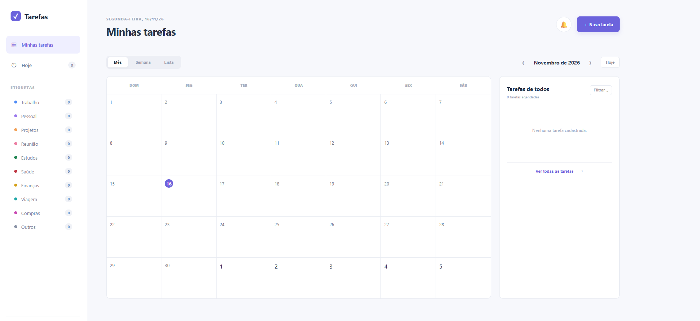

# 📅 Taskly — Sistema de Gestão de Tarefas

**Organize sua rotina de forma simples, visual e inteligente.**

<p align="center">
  <a href="https://taskly-public-sand.vercel.app/">
    
  </a>
</p>

<p align="center">
  
  
  
  
  
  
</p>

---


---

## 📖 Sobre o Projeto

O **Taskly** é uma aplicação web Full Stack desenvolvida como projeto acadêmico para a avaliação A3.

A plataforma foi criada para facilitar o gerenciamento de tarefas e compromissos, permitindo que os usuários organizem suas rotinas por meio de um calendário interativo, com recursos de categorização, definição de prioridades, notificações e controle de acesso baseado em perfis.

O sistema possui três níveis de acesso: Administrador, Gerente e Usuário Comum.

## ✨ Funcionalidades

- **Autenticação de Usuários:** Cadastro e login com criptografia de senhas utilizando Bcrypt e autenticação por tokens JWT.
- **Controle de Acesso (RBAC):** Gerenciamento de permissões conforme os níveis de acesso: Administrador e Usuários
- **Gestão de Tarefas (CRUD):** Criação, edição, listagem e exclusão de tarefas.
- **Calendário Interativo:** Visualização de compromissos nos formatos mensal, semanal e em lista.
- **Filtros Avançados:** Organização de tarefas por etiquetas, prioridades e períodos, incluindo tarefas vencidas e próximos 7 dias.
- **Sistema de Notificações:** Alertas visuais por meio de notificações e mensagens Toast para tarefas vencidas ou próximas do prazo.
- **Design Responsivo:** Interface adaptável para computadores e dispositivos móveis.

## 📸 Screenshots

\<p align="center">
&#x20; \
&#x20; \
\</p>

## 🛠️ Tecnologias Utilizadas

### Frontend

- **HTML5:** Estruturação das páginas.
- **CSS3:** Estilização e desenvolvimento de interface responsiva.
- **JavaScript Vanilla:** Manipulação do DOM, interatividade e consumo de APIs REST.

### Backend

- **Node.js:** Ambiente de execução JavaScript no servidor.
- **Express.js:** Desenvolvimento e gerenciamento das rotas da API REST.
- **JWT (JSON Web Tokens):** Autenticação e gerenciamento de sessões.
- **Bcrypt:** Criptografia de senhas por meio de hash.

### Banco de Dados

- **SQLite:** Banco de dados relacional para armazenamento das informações da aplicação.

### Deploy

- **Vercel:** Hospedagem da aplicação.

## 📂 Estrutura do Repositório

```text
Taskly/
├── taskly/          # Código do Frontend (HTML, CSS e JavaScript)
├── images/          # Imagens e screenshots do projeto
├── public/          # Arquivos estáticos servidos pelo Express
├── server.js        # Arquivo principal do servidor e API
├── package.json     # Dependências e configurações do projeto
└── README.md        # Documentação do projeto
```

## 🚀 Como executar o projeto localmente

### Pré-requisitos

Antes de iniciar, certifique-se de possuir as seguintes ferramentas instaladas:

- [Git](https://git-scm.com/)
- [Node.js](https://nodejs.org/)
- [Visual Studio Code](https://code.visualstudio.com/)

### 1. Clonar o repositório

Abra o terminal e execute:

```bash
git clone https://github.com/rael-program/Taskly.git
```

Entre na pasta do projeto:

```bash
cd Taskly
```

### 2. Instalar as dependências

Execute o comando:

```bash
npm install
```

### 3. Iniciar o Backend

Execute:

```bash
node server.js
```

O servidor estará disponível em:

```text
http://localhost:3000
```

O banco de dados `taskly.db` será criado automaticamente na primeira execução, conforme a configuração do servidor.

### 4. Executar o Frontend

Abra a pasta `taskly/` no Visual Studio Code e utilize a extensão **Live Server** para executar o arquivo `index.html`.

**Importante:** Para executar o projeto localmente, verifique se a variável `API_BASE`, presente nos arquivos JavaScript do frontend, está configurada para apontar para:

```javascript
http://localhost:3000/api
```

## ☁️ Deploy

A aplicação está hospedada na Vercel e pode ser acessada publicamente pelo link:

🔗 [**https://taskly-public-sand.vercel.app/**](https://taskly-public-sand.vercel.app/)

## 👥 Desenvolvedores

Projeto desenvolvido em equipe como requisito para a avaliação acadêmica A3.

- **Israel Figueiredo Brito** — Desenvolvedor Principal

---

